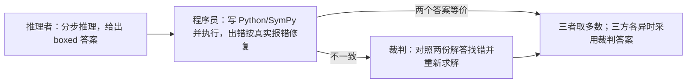
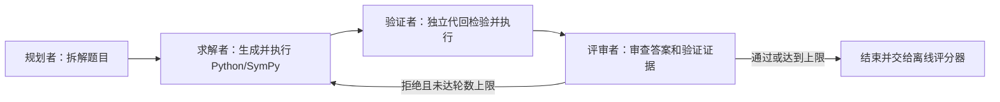

# 多 Agent 数学解题实验

用 LangGraph 实现规划者、求解者、验证者和评审者，并与单次回答、单 Agent + 工具比较。第三版流程与强弱模型对照的完整结论见 `COMPARISON_REPORT.md`；此前每个数据集 20 题的优化前后对照见 `VALIDATION_REPORT.md`；最初连通性测试保留在 `TEST_REPORT.md`。尚未进行全量评测，小样本结果不能代表整个基准准确率。

本次样本：GSM8K 多 Agent 正确率由 30% 提升至 85%；MATH-500 维持 30%，低于单 Agent + 工具的 45%。双方都完成的同题上，token 分别下降约 54% 和 46%。最终容器回归测试 28 项通过。原始 API 超时和其他失败记录均保留。

## 第三版流程 consensus（当前默认）

前两版在 MATH-500 上只有 30% 的原因和对应改动：

| 问题 | 表现 | 改动 |
|---|---|---|
| 所有 Agent 只能回复一个 JSON 答案，没有推理空间 | direct 在 GSM8K 20 题全错、MATH-500 10%，远低于该模型分步推理的水平 | 改为自由文本分步推理，答案取最后一个 `\boxed{}`；代码取 ```python 代码块，不再使用 JSON 模式 |
| 规划者心算出错，求解者照抄成 `print('2403_6')` | 代码只是打印心算结果 | 去掉规划者；程序 Agent 必须由题目条件计算 |
| 验证者写的 PASS/FAIL 检查比求解者更容易错，却拥有否决权 | 20 题中 13 题用满 3 轮，正确答案（如 8）被改成错误答案（12） | 去掉代码验证者；以“推理”和“程序”两条独立路线的答案等价作为通过信号 |
| 输出格式过严、浮点噪声 | 空输出、`58.99999999999818`、未化简的根式 | 取最后一行输出，清理浮点噪声，沙箱内对 SymPy 结果化简后输出 LaTeX |
| API 超时即整题作废 | 每 20 题 1–3 题因 ReadTimeout 记零分 | 超时/429/5xx 自动重试（`MATH_API_RETRIES`，默认 2，次数记入 usage）；单个 Agent 失败保留其他 Agent 的答案 |
| 串行运行 | 20 题需十几分钟 | `--workers N` 多进程并行（`./lab` 默认 4，可用 `MATH_WORKERS` 调整） |



答案等价用 Math-Verify 判断，全程不接触标准答案。consensus 下三种模式的含义：direct 为单次分步推理，single 为程序 Agent（含修复），multi 为完整流程。`--max-rounds` 表示程序修复的最多尝试次数。

实测（SiliconFlow / Qwen2.5-7B-Instruct，温度 0，2026-11-14）：

| 样本 | 流程/模式 | 正确率 | API 异常 | 平均模型调用 |
|---|---|---:|---:|---:|
| MATH-500 验证 20 题 | 原版 multi | 6/20 (30%) | 0 | 13.0 |
| 同上 | optimized multi | 6/20 (30%) | 2 | 6.2 |
| 同上 | consensus direct（单次推理） | 13/20 (65%) | 0 | 1 |
| 同上 | consensus single（程序） | 11/20 (55%) | 0 | 1.2 |
| 同上 | consensus multi | 13/20 (65%) | 0 | 2.7 |
| MATH-500 新抽 100 题 | consensus multi | 84/100 (84%，95% Wilson 区间约 76%–90%) | 0 | 2.65 |

新抽 100 题中各 Agent 单独的正确数：推理者 81、程序员 63；61 题两者一致直接采纳，39 题进入裁判。多 Agent 相对单次推理的增益为 +3 题，在抽样误差范围内：主要提升来自允许模型推理和去掉不可靠的否决环节，而不是角色数量。修改沙箱输出化简之前的同一批题第一次运行为 82/100，两次差异也反映了远程模型的运行波动。结果目录：`results/consensus-validation20-math500`、`results/consensus-fresh100-math500`（82）、`results/consensus-fresh100-math500-v2`（84）。

### 异构模型对照（同一批 100 题）

可用 `MATH_REFEREE_MODEL`、`MATH_REASONER_MODEL`、`MATH_CODER_MODEL` 为各角色单独指定模型，未设置时使用 `MATH_MODEL`；每次调用实际使用的模型记录在 usage 的 `model` 字段。

| 配置 | 正确率 | DeepSeek 输入/输出 token | 平均延迟 |
|---|---:|---:|---:|
| 全 Qwen2.5-7B，consensus multi | 84% | 0 | 44 s |
| Qwen2.5-7B 推理+程序，DeepSeek-V4.1-Flash 只当裁判（44 题进入裁判） | 96% | 5.4 万 / 11.3 万 | 44 s |
| 全 DeepSeek-V4.1-Flash，单次推理 direct | 97% | 2.0 万 / 8.5 万 | 11 s |
| 全 DeepSeek-V4.1-Flash，consensus multi | 99% | 4.9 万 / 24.8 万 | 45 s |

结论：小模型+强裁判把准确率从 84% 提到 96%，但裁判要阅读两份解答并重新推导，消耗的强模型 token 反而多于直接让强模型做全部 100 题，且准确率不高于后者（96% 对 97%）。若把分歧题改为让强模型从头独立解（用已有结果离线推算，未实际运行）：约 94%，强模型输出 token 约为全量的 65%。全 DeepSeek 多 Agent 的 99% 对 97% 只差 2 题，在抽样误差内，而输出 token 约 2.9 倍。MATH-500 对该模型已接近饱和，无法在这个基准上体现多 Agent 的价值。结果目录：`results/hybrid-fresh100-math500`、`results/deepseek-direct-fresh100-math500`。

注意：20 题验证集的失败记录在设计本流程时被查看过，因此另取 100 道未查看过的题（`data/math500-fresh100.jsonl`，种子 20261115，排除之前用过的 24 题）作为主要依据。尚未跑全量 500 题；`./lab run math500 all` 可得到完整结果。旧流程仍可用 `./lab run math500 20 optimized` 或 `baseline` 复现。

## Docker 一键运行（推荐入口）

在此项目目录运行 `./lab setup`，完成应用镜像和 SymPy 沙箱镜像构建、容器测试、GSM8K 和 MATH-500 测试集下载。Mac 上安装 Colima、Docker CLI 和 Compose 后，脚本会自动启动 Docker Engine；也兼容已启动的 Docker Desktop。

编辑项目根目录 `.env`，填写三个值（不要加引号）：

```dotenv
MATH_API_KEY=你的密钥
MATH_BASE_URL=https://你的服务商地址/v1
MATH_MODEL=你的模型名称
```

你选择了其他兼容 OpenAI 的服务，因此地址和模型名需要按服务商提供的信息填写。`./lab` 自动通过 Compose 加载 `.env`，无需执行 `export`。该文件已被 Git 忽略，并排除在镜像构建上下文之外。费用价格为可选项，不填写时只统计 token，费用显示为空。

```bash
./lab demo                 # 无 API 的流程演示
./lab test                 # 包括真实 Docker 执行、超时和错误处理
./lab run gsm8k 20         # 三组对照，先测 20 题
./lab run math500 20
./lab run gsm8k all        # 全量，消耗更多 API 配额
./lab run math500 all
```

结果自动保存到本机 `results/数据集-时间戳-进程号/`。重新开机后可直接运行上述命令，脚本会在必要时启动 Colima；停止环境使用 `colima stop`。这是命令行实验系统，无需打开网页或常驻服务。

应用容器使用 Docker socket 创建受限的独立沙箱。只有受信任的应用容器持有 socket 和 API 配置；模型生成代码所在沙箱不挂载 socket、项目目录或密钥。不要在应用容器中直接执行模型生成代码。

本机首次部署通过已有 Clash 代理（端口 7897）下载依赖。Docker Engine 使用该代理拉取镜像；重建镜像时请保持代理运行。若遇到 Docker Hub 认证连接超时，可执行：

```bash
HTTPS_PROXY=http://127.0.0.1:7897 HTTP_PROXY=http://127.0.0.1:7897 \
  docker compose build --build-arg HTTPS_PROXY=http://192.168.5.2:7897 \
  --build-arg HTTP_PROXY=http://192.168.5.2:7897 lab sandbox
```

日常运行使用已构建的镜像，不需要重新构建。[Colima 安装说明](https://colima.run/docs/installation/)与[代理配置说明](https://colima.run/docs/configuration/)供迁移环境时参考。

模型 API 的代理与镜像下载分开配置。当前 SiliconFlow 服务采用 `MATH_PROXY_URL=`（留空，明确直连），并为应用容器设置 DNS `223.5.5.5` 和 `119.29.29.29`。实测原容器 DNS 解析失败，Clash 路径出现 TLS 中断；修复 DNS 后直连认证成功。没有修改系统代理或 Clash 规则。

若换用需要代理的服务，可设置 `MATH_PROXY_URL=http://192.168.5.2:7897`，让应用容器通过 Mac 的 Clash 代理访问模型服务。容器内 `127.0.0.1` 指向容器自身。客户端忽略全局 `HTTP_PROXY` / `NO_PROXY`，使用这个项目的显式路由；不会在代理失败后自动直连。`MATH_API_TIMEOUT=120` 控制 API 读写超时秒数，连接超时为 15 秒。[HTTPX 代理说明](https://www.python-httpx.org/advanced/proxies/)。

当前 SiliconFlow 配置还启用了 `MATH_JSON_MODE=true`，向 API 发送 `response_format={"type":"json_object"}`，避免模型返回 Markdown 代码块或非法 JSON。切换到不支持该参数的服务时设为 `false`。JSON 格式正确不代表答案或生成代码正确。[SiliconFlow JSON 模式说明](https://docs.siliconflow.cn/docs/userguide/guides/json-mode)。实验清单记录 JSON 模式与是否使用 API 代理，不记录密钥。

下面保留本机 Python 安装方法，使用 Docker 入口时无需重复安装。



下面是第二版（optimized）与原版的说明。优化版：求解者生成代码，程序直接提取成功执行后的一行输出作为答案，并在沙箱中将 SymPy 对象转换为精确 LaTeX。空输出和执行失败触发修复，不再由模型根据错误信息猜答案。验证者只读取原题与候选答案，独立生成检查代码；检查程序出错时保留候选答案，优先修复检查。评审者不能覆盖执行失败、缺失答案或未通过的验证。内部评审仍可能误判，最终准确率由独立评分器对照标准答案计算。

原版（baseline）保留生成代码后调用 finalizer 提取答案的流程。通过 `./lab run gsm8k 20 baseline` 或 CLI 的 `--workflow baseline` 可复现；`--workflow consensus` 是默认值；在 baseline 与 optimized 下 direct 与 single 两种对照模式保持原实现不变。

## 安装与离线运行

需要 Python 3.11+。在项目目录运行：

```bash
python3 -m venv .venv
source .venv/bin/activate
pip install -r requirements.lock
pip install -e . --no-deps
pytest -q
math-lab run --demo --data data/demo.jsonl --output results/demo
```

无需密钥、网络或 Docker 的演示使用两个自编题目、固定模型回复与固定工具输出；不会实际执行生成代码。每次使用新的输出目录，避免覆盖已有实验。也可不安装入口脚本，使用 `PYTHONPATH=src .venv/bin/python -m math_agents.cli` 替代 `math-lab`。

## 真实实验

先安装并启动 Docker，构建 SymPy 工具镜像：

```bash
docker build -t math-agent-python:local sandbox
export MATH_API_KEY='your-api-key'
export MATH_BASE_URL='https://your-provider.example/v1'
export MATH_MODEL='your-model'
```

适配器要求服务支持 Chat Completions 的 `messages`、`temperature`、`max_tokens` 与文本 JSON 回复；不支持这些参数的模型需要修改 `backend.py`。配置示例见 `.env.example`。直接运行本机 `math-lab` 时使用终端环境变量；Docker 入口 `./lab` 自动读取 `.env`。

下载官方测试集并先跑小样本：

```bash
math-lab prepare --dataset gsm8k --output data/gsm8k.jsonl
math-lab prepare --dataset math500 --output data/math500.jsonl
math-lab run --data data/gsm8k.jsonl --limit 20 --seed 42 --output results/gsm8k-pilot
math-lab run --data data/math500.jsonl --limit 20 --seed 42 --output results/math500-pilot
```

去掉 `--limit` 即运行整个测试集。`prepare --revision COMMIT_SHA` 可固定数据版本；下载时保留 fingerprint，运行时记录本地文件 SHA-256 和实际抽样题号。建议正式实验保留下载的 JSONL 与对应 `.meta.json`，分别运行多个抽样种子并报告波动。种子控制样本顺序和选取，不保证远程模型确定性。

默认三种模式都运行，可用 `--modes direct single multi` 指定；每组使用相同题目、模型、温度与每次调用的输出 token 上限。标准答案和参考解答不会进入 Agent 提示词。瞬时 API 失败会重试（次数记入 usage）；重试后仍失败则记录为失败样本并计入准确率分母。

| 模式 | 行为 | 默认上限（max-rounds=3） |
| --- | --- | --- |
| direct | 单次回答，无工具 | 1 次模型调用 |
| single | 同一 Agent 根据工具历史继续推理，最后一轮必须作答 | 3 次模型调用、最多 2 次工具调用 |
| multi（优化版） | 规划一次，然后求解→验证→评审；技术故障按需修复 | 最多 10 次模型调用、最多 6 次工具调用 |
| multi（原版） | 每轮额外调用 finalizer，拒绝时重做求解与验证 | 最多 13 次模型调用、最多 6 次工具调用 |

`rounds` 在 direct 中是 1；single 中是 Agent 决策次数；multi 中是求解—验证—评审循环次数。**不同模式的轮数含义不同，计算量应比较 token 和模型调用数。** 这些对照衡量完整系统的质量与成本，不是等 token 预算实验，不能将提升单独归因于角色拆分。严谨研究应另外做相同总 token 预算的对照、去掉验证者/评审者的消融实验。

## 结果与评分

每次运行生成：

- `manifest.json`：参数、模型、提示词、样本题号、数据哈希、依赖版本与价格。
- `results.jsonl`：逐题预测、离线评分、各角色输入输出、工具结果、用量、耗时与错误类型；每题完成即刷新。
- `summary.json` / `summary.csv`：按数据集和模式汇总准确率、错误数、未解析数、平均轮数、模型/工具调用数、输入输出 token、预估美元费用与延迟。

GSM8K 使用最终数值的精确有理数比较，支持千分位、分数、小数与 boxed 答案，不从任意叙述中猜取最后一个数字。MATH-500 使用 Hugging Face Math-Verify 解析 LaTeX 并判断等价，设置解析/验证超时。无法解析或超时记为错误答案，并单列评分状态；集合、区间、单位及证明题等边界案例需要抽样人工复核。

达到重做上限时仍评分最后一次候选答案，并保留 `accepted=false`；内部通过率不等于基准准确率。模型按题目顺序运行，因此延迟包含多次调用和容器启动时间。

token 使用服务返回的 `usage`，不估算。缺失 usage 时汇总用量为 `null`，避免低报。价格需按所选模型和实际服务自行设置每百万 token 美元单价：

```bash
export MATH_INPUT_PRICE='2.0'   # 仅示例，并非任何模型的报价
export MATH_OUTPUT_PRICE='8.0'
export MATH_CACHED_PRICE='1.0'
```

费用公式为 `(非缓存输入×输入价格 + 缓存输入×缓存价格 + 输出×输出价格) / 1e6`。未配置必要价格时费用为 `null`；API 出错但服务端已计费的部分无法自动恢复。费用是按返回用量计算的估值，不替代账单。演示用量为固定的零值。

## 执行隔离与测试范围

生成的 Python 仅在 Docker 内执行：无网络、无宿主挂载、不传密钥、非 root、根目录只读，限制内存、CPU、进程数、临时目录与执行时间。宿主只保留前 16 KB 工具输出。没有提供不受隔离的本机执行回退。

测试覆盖真实 LangGraph 分支、重做上限、验证失败拒绝、JSON 解析失败、抽样一致性、数值/符号评分、缓存费用、HTTP 适配器和汇总。2026-11-14 已完成本机 Docker 部署，应用容器内全部 21 项测试通过，包括真实 SymPy 执行、沙箱隔离、四角色调用和超时终止。两个官方测试集已下载到 `data/`。后续已完成真实 API 连接和小样本测试，最新网络配置与结果见 `TEST_REPORT.md`。

```bash
MATH_TEST_DOCKER=1 pytest tests/test_execution.py -q
```

参考：[LangGraph StateGraph](https://reference.langchain.com/python/langgraph/graph/state/StateGraph)、[GSM8K](https://huggingface.co/datasets/openai/gsm8k)、[MATH-500](https://huggingface.co/datasets/HuggingFaceH4/MATH-500)、[Math-Verify](https://github.com/huggingface/Math-Verify)。
